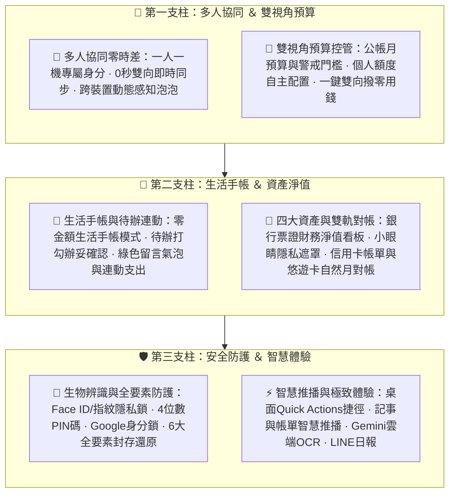

# 💖 甜心記帳本 (Sweetheart Family Ledger)
### 專為現代家庭量身打造的跨平台共同記帳與生活手帳協同系統

> **「記帳不再是繁瑣的對帳討債，而是全家人共同守護生活的美好儀式。」**

---

## 📖 產品目錄
1. [🌟 產品簡介與核心理念](#-產品簡介與核心理念)
2. [🎯 解決現代家庭的四大記帳痛點](#-解決現代家庭的四大記帳痛點)
3. [✨ 六大核心價值主張](#-六大核心價值主張)
4. [📱 十四大產品功能模組矩陣](#-十四大產品功能模組矩陣)
5. [🏡 四大家庭日常實用情境演繹](#-四大家庭日常實用情境演繹)
6. [🛡️ 隱私安全與資料自主保障](#-隱私安全與資料自主保障)
7. [💻 多端跨平台支援與技術亮點](#-多端跨平台支援與技術亮點)
8. [🚀 快速開始與版本資訊](#-快速開始與版本資訊)

---

## 🌟 產品簡介與核心理念

**「甜心記帳本」**是一套以**「家庭公帳、共同分擔、生活協同」**為核心靈魂的跨平台記帳系統。基於 **React Native + Expo SDK 57** 與 **Supabase PostgreSQL Realtime** 現代化雲端架構打造，兼具手機原生 App 的流暢手感與電腦大螢幕網頁端的極致對帳效率。

市面上傳統記帳軟體多半圍繞「個人收支」或「生硬冰冷的 AA 制拆帳討債」，忽視了家庭生活中充滿溫度的分工與關懷。在甜心記帳本中：
* **每一筆支出**，都是為家庭付出的一份心意；
* **每一張生活備忘**，都是伴侶與孩子間無聲的默契與交代；
* **每一次悠遊卡加值與零用錢發放**，都能自動平衡公帳，金流清清楚楚卻毫無壓力；
* **每一次預算提醒與發票對獎**，都讓家庭理財充滿安全感與生活驚喜。

---

## 🎯 解決現代家庭的四大記帳痛點

| 常見痛點 | 傳統記帳軟體的問題 | 💖 甜心記帳本的優雅解法 |
| :--- | :--- | :--- |
| **痛點 1：各記各的、資料分散** | 夫妻各自用不同 App 記帳，每到月底根本不知道全家總共花去哪裡。 | **多人即時雙向連線**：一人一機綁定家庭稱謂，一人記帳全家秒同步，隨時掌握全家財務全貌。 |
| **痛點 2：生硬 AA 算帳破壞家庭感情** | 傳統拆帳軟體充滿借還款、討債結算介面，家庭記帳變得斤斤計較。 | **家庭公帳共同分擔**：以雙視角預算控管與公帳平衡為核心，免除借貸壓力；支援雙向零用錢收支自動平衡。 |
| **痛點 3：記帳與生活待辦脫節** | 超市採買清單在備忘錄，採買完又要打開記帳軟體手動補記，常常忘記漏記。 | **生活手帳 ＋ 辦妥打勾 ＋ 連動記帳**：採買清單隨手打勾，一秒連動轉為公帳支出，自動保留採買回報氣泡與推播提醒。 |
| **痛點 4：信用卡、悠遊卡對帳一團亂** | 悠遊卡儲值到底算支出還是轉帳？信用卡帳單週期與月曆收支對不上。 | **四大資產淨值 ＋ 雙軌對帳看板**：統整銀行票證資產淨值，信用卡依帳單週期結算、悠遊卡依自然月對帳，支援動態加值與出帳提醒。 |

---

## ✨ 六大核心價值主張

---

## 📱 十四大產品功能模組矩陣

### 1. 📝 智慧記帳與生活手帳（流水帳清單）
* **收支與轉帳極速記錄**：支援支出、收入、內部轉帳（卡片儲值、成員調撥），自帶智慧記憶常用店家與分類圖示。
* **發生時間 (時:分) 精準微調**：支援時分自訂調整與「🕒 設為現在」快捷鍵，編輯後自動依真實時間排序歸位，解決早上記昨晚消費時間顛倒痛點。
* **手帳手記模式（$0 記錄生活）**：一鍵切換 `[ 📝 記事 ]`，記錄生活雜記、靈感或採買備忘，**100% 嚴格排除於財務收支統計**，財務報表永遠乾淨精準。
* **正文超連結與全形標籤支援**：自動識別網址轉換為藍字超連結跳轉外部瀏覽器；支援全形［ ］、半形 [ ] 與粗括號【 】標籤自動提取主題。
* **即時搜尋列與熱門店家膠囊**：支援店家名稱與備註即時搜尋，自動提取常去店家以橫向膠囊陳列（如 `[好市多]`），一鍵快篩並動態試算店家累積花費。

### 2. 📋 生活備忘待辦與打勾辦妥連動（Memo Todo System）
* **五大分頁待辦總覽**：集中「全部待辦」、「🚨 逾期」、「🔔 今日」、「🕒 未來待辦」與「✓ 已完成」，直觀掌握待辦事項進度與倒數天數。
* **辦妥確認彈窗 (`MemoCompletionModal`)**：點擊待辦勾勾時呼叫專屬確認視窗，可自由選擇辦妥成員、填寫「辦妥補充說明/回報」、快捷情境標籤。
* **連動支出記帳 (`linked_transaction_id`)**：採買辦妥一鍵轉公帳支出，雙向智慧綁定，卡片直接展示連動支出膠囊，點擊一秒跳轉查看。
* **連動取消退回防護**：連動記帳途中若按取消，系統自動退回辦妥彈窗，回報備註與人員狀態 100% 完好保留，絕不遺失草稿。
* **精緻綠色留言氣泡**：已辦妥卡片以綠色氣泡呈現補充回報（如「已於全聯買齊、發票放鞋櫃」），家庭分工交代一目了然。

### 3. 🎯 雙視角預算控管與即時 WebSocket 雲端同步（Budget Management）
* **家庭公帳月度預算與 80% 警戒門檻**：支援配置公帳月度總預算與分類預算，以動態彩色進度條與百分比即時警示，超支一目了然。
* **成員個人開銷額度自主掌控**：每位成員可於自己手機上設定專屬個人開銷額度，各成員額度互不干涉，管理員亦可協助輔助配置。
* **管理員專屬權限防護**：公帳總預算僅管理員可設定修改，一般成員提供唯讀瀏覽模式與提示徽章。
* **WebSocket 秒級雲端雙向同步**：`ledger_budgets` 全面納入 Supabase Realtime WebSocket 監聽，一人調整額度，全家全體裝置秒級連動更新。

### 4. 💎 四大資產、信用卡待繳與財務淨值看板（Net Worth Dashboard）
* **四大資產型態全要素整合**：統整銀行帳戶、現金皮夾、儲值票證（悠遊卡/一卡通）與信用卡待繳負債，動態算出即時財務淨值。
* **個人淨值 vs. 家庭淨值智慧切換**：預設精確呈現本機成員個人的資產、信用卡待繳與「個人財務淨值」；切換篩選至「全部成員」才統整全家所有帳戶展示「家庭財務淨值」。
* **小眼睛隱私遮罩**：首頁資產看板金額預設啟用星號遮罩 (`NT$ ••••••`)，保護在公共場合檢視帳本時的隱私。
* **折疊式展開明細清單**：點擊一鍵展開完整帳戶明細，各卡片即時餘額、持卡人與待繳金額清晰可見。

### 5. 📊 多維度財務統計、排行榜與走勢圖表
* **四大核心財務 KPI**：總支出（含出資轉出）、總收入、當月結餘、家庭公帳淨結算即時計算。
* **類別支出排行榜**：動態彩色佔比進度條，清晰呈現飲食、居家、交通、教育育兒各類別花費佔比。
* **成員支出貢獻分佈**：清楚看見每位家庭成員在當月家庭公帳中的出資比例，感謝每一位成員的付出。
* **收支走勢圖與歷史月份快速穿透**：提供清晰月度收支走勢折線圖與 12 個月網格任意挑選彈窗，數年歷史明細秒查秒翻。

### 6. 💳 週期扣款、水電瓦斯與信用卡分期管理
* **水電瓦斯固定帳單（單雙月排程）**：完美相容台灣台電、自來水、天然氣單雙月繳排程，提供到期提醒與「一鍵確認入帳」待繳核對清單。
* **信用卡分期付款追蹤**：支援 3~36 期自訂期數，每期自動標記 `(第 X/Y 期)`，附帶已繳金額視覺進度條，繳滿全額自動除役。
* **電子帳單雲端保管庫**：每張信用卡支援獨立上傳 PDF 或圖片格式之電子帳單，支援安全下載與原圖預覽，出門在外帳單不漏勾。

### 7. 🚌 悠遊卡/儲值卡通用動態加值與自然月對帳
* **通用動態出資來源**：告別寫死選項，加值時動態讀取家庭啟用的支付方式（現金、信用卡、銀行轉帳、悠遊付、街口等）。
* **悠遊付/電子支付多元出資**：支援悠遊付、街口以錢包餘額或綁定信用卡加值入帳，精準對應日常使用悠遊付 App 靠卡加值之記帳需求。
* **特定銀行子帳戶連動**：銀行轉帳出資可自選特定銀行帳戶（如台新 Richart、玉山），精確掌握出資水庫。
* **內部轉帳專屬終點卡片**：查看加值明細獨立展示「📥 轉入目標卡片 (終點)：🚌 卡片名稱 (持卡人·即時餘額)」，店家與備註開放自由輸入。
* **自然月嚴格排他對帳**：重構篩選演算法，依專屬帳戶 ID 精確判定卡片歸屬，指向別卡之加值 100% 嚴格排除，徹底杜絕跨卡重複計入。

### 8. 👨‍👩‍👧 家庭協作與雙向零用錢機制
* **一人一機身分識別**：每位家庭成員手機清楚標示 `📱 我 (本機)`，記帳自動帶入本人，亦可代家人記帳。
* **雙向撥零用錢機制**：家長撥款時自動記錄「家長轉出支出」與「小孩零用錢收入」，小孩帳戶具備正向結餘且維持家庭公帳總額平衡。
* **個人卡片自主管理**：個人信用卡、悠遊卡、銀行帳戶由本人自主新增、編輯、刪除與校正餘額；管理員享全家代管權限。
* **代記帳人編輯權限**：代家人記錄之明細，建立者享有完整後續編輯權限；非出資者瀏覽自動開啟「🔒 唯讀模式」保護。

### 9. 🔐 Face ID / 指紋辨識隱私防護鎖與企業級資安
* **原生生物辨識身分保護**：深度整合 `expo-local-authentication`，支援 iOS Face ID / Touch ID 與 Android 指紋辨識 / 人臉解鎖。
* **資產淨值隱私小眼睛解鎖**：資產看板與帳戶金額預設星號遮罩，輕觸指紋或 Face ID 秒速解除遮罩淡入真實數字。
* **App 啟動與背景喚醒防護鎖**：冷啟動或自背景返回 App 時強制驗證生物辨識或輸入 4 碼 PIN 碼解鎖，徹底守護家庭帳本私密性。
* **4 位數安全 PIN 碼與緊急救援**：預設 `8888`，管理員可自由修改，新裝置認領管理員或敏感操作強制驗證；最後一位管理員防呆保護。
* **Google 帳號身分電子鎖**：可選升級綁定 Google 帳號，名冊顯示「🔒 已保護」，換機憑 Google 登入一秒找回專屬身分。
* **連線設備感知管理**：家庭名冊展示「📱 X 台裝置」在線徽章，可查看連線裝置名稱、型號、版本並一鍵踢除舊設備。

### 10. 🔔 生活記事與信用卡帳單智慧推播雙軌系統
* **生活記事到期本機推播**：支援設定提醒日期之生活記事於當天上午 09:00 本機推送通知（`expo-notifications`），重要祭祀與紀念日前夕預警。
* **記事辦妥即時排程同步**：記事在 App 內被勾選辦妥完成時，自動即時取消本機通知排程，精準不打擾。
* **信用卡出帳與繳款雙軌提醒**：出帳日隔天 09:30 與繳款到期前 3 天 09:30 本機智慧推播提醒，精準提示待繳金額防忘繳。
* **每日 LINE 收支日報雙向連動**：收支日報新增「📌 生活記事與待辦備忘提醒」專屬卡片與帳單提醒標籤，全家群組溫馨提醒。

### 11. ⚡ 手機桌面 Quick Actions 快捷直達與 Deep Linking
* **桌面長按快捷直達**：支援 iOS 與 Android 手機桌面長按 App 圖示，彈出「記一筆支出」、「記一筆收入」、「掃描發票 / 收據」、「隨手記記事」4 大捷徑選單，一秒直達對應表單。
* **相機掃描直通**：選擇「掃描發票 / 收據」捷徑自動直達發票掃描器，相機即刻開啟並自動辨識填寫明細。
* **Deep Link 外部協議支援**：支援 `familyledger://quick-action?mode=scan|expense|income|memo` 自訂 URL Scheme，可串接 iOS 捷徑、Siri 語音或外部自動化呼叫。
* **隱私鎖安全佇列**：若啟用生物辨識防護，長按捷徑進入時先通過生物辨識驗證，通過後自動流暢執行所選動作，兼顧隱私與效率。

### 12. 📷 統一發票雙 QR Code 智慧掃描、Gemini 雲端 OCR 與自動對獎中心
* **發票雙條碼鏡頭即時並排掃描**：獨創左右雙條碼並排對焦框，鏡頭對準電子發票左右雙 QR Code，單畫面秒速辨識號碼、金額、消費日期、店家統編與購物明細。
* **Google Gemini 多模態雲端安全辨識**：建立 Supabase Edge Function (`gemini-ocr`)，將 Gemini API 金鑰安全封存於雲端後台（用戶端零暴露），支援傳統長條收據與手寫發票高精辨識，並具備前端備援。
* **大賣場長明細雙條碼無縫合體**：好市多、全聯等長商品清單發票，自動連續捕捉左右碼溢位明細並智慧融合成單筆記錄，附帶 2 秒容錯自動完成機制。
* **雲端發票相簿截圖解析**：支援從手機相簿直接挑選載具或發票截圖自動解析，完美解決雲端發票無實體紙本痛點。
* **百大連鎖統編自動辨識**：內建全聯、好市多、家樂福、四大超商、中油等百大統編庫，掃碼帶入店家與分類，兼具小店記憶學習。
* **開獎比對與對獎中心一鍵兌領**：卡片即時亮起「🎉 中獎 NT$ 200 (六獎)」徽章，對獎中心支援「一鍵兌領入帳」自動產生收入平帳並歸屬原記帳人。

### 13. 🛡️ 企業級資安、PIN 碼防護與全要素備份
* **6 大全要素封存指標網格**：完整備份交易、成員、分類、卡片、週期/分期、付款方式，支援安全合併與完全覆蓋還原。
* **家庭門禁安全鎖**：家庭設定新增新成員加入通道開關，上鎖時全面阻斷持邀請碼之新訪客加入並隱藏家庭名冊，有效防範邀請碼外流風險。
* **資料自主權 100% 歸還家庭**：隨時支援全要素一鍵匯出 JSON 備份檔與 CSV 報表，跨裝置還原零失真。

### 14. ⚡ 離線優先技術、全域安全邊界與 LINE 每日家庭收支報表
* **離線優先（Local-First）**：無網路或賣場地下室仍可流暢記帳，離線寫入佇列在連網後背景自動重試同步，數萬筆資料依然秒開。
* **防禦型原生模組相容架構**：原生模組動態探測載入與優雅降級，未編譯原生模組之舊環境自動切換 PIN 碼防護，徹底杜絕 OTA 黑屏。
* **全域根層安全邊界 (Root Error Boundary)**：於應用程式最外層掛載保護層，攔截任何未預期例外執行緒，呈現友善提示與一鍵恢復按鈕。
* **EAS Update 雲端無感熱更新**：介面微調與功能升級自動背景下載套用，免去頻繁重新下載安裝 APK 的困擾。
* **LINE 每日 Flex 卡片收支日報**：透過 GitHub Actions 每日 21:30 定時運算家庭收支，自動推播精緻 Flex Message 圖文卡片至 LINE 家庭群組；同時自動對 Supabase 進行保活打卡，永不休眠！

---

## 🏡 四大家庭日常實用情境演繹

### 情境 A：太太超市採買（生活待辦 ➔ 綠色回報 ➔ 採買連動支出）
1. 先生出門前在甜心記帳本留下一則生活待辦：`［採買］鮮奶兩大瓶、雞蛋一盒、牛排`。
2. 太太在超市買妥後，打開 App 點擊勾勾，彈出「辦妥確認彈窗」，填寫補充說明：「已在全聯買好特價鮮奶，牛排去好市多買」。
3. 點選「💳 連動記一筆支出」，輸入金額 $420，選擇付款方式為全聯福利卡。
4. 儲存後，先生的手機頂部滑下即時推播泡泡：`✓ 太太 辦妥了一項待辦！`，卡片呈現綠色回報留言氣泡，並附帶 `💳 支出 NT$ 420` 膠囊按鈕，點擊一秒查看明細。

### 情境 B：月初家長發放孩子零用錢
1. 爸爸在 App 點選「新增 ➔ 內部轉帳」，選擇「發放零用錢」。
2. 出資人選爸爸（從薪轉戶扣除 $1,000），受款成員選「豆豆」。
3. 系統自動入帳：
   * 爸爸帳上記錄一筆 $1,000 出資；
   * 豆豆的零用錢錢包即時增加 $1,000 結餘；
   * 家庭公帳總結餘維持不變，不重複虛增支出，孩子隨時能用自己手機查看零用錢餘額。

### 情境 C：通勤捷運悠遊卡手機感應加值
1. 媽媽在捷運站以手機悠遊付感應為「富邦J悠遊卡」加值 $500。
2. 打開記帳本點選悠遊卡小工具「快速加值」：
   * 選擇卡片：富邦J悠遊卡
   * 出資付款方式：點選「悠遊付」，系統自動帶入「悠遊付錢包」
   * 金額輸入：$500
3. 系統自動建立內部轉帳明細，明細清楚顯示「📥 轉入目標卡片：富邦J悠遊卡」，店家可隨時改填為「台北捷運市府站」。
4. 月末查看「富邦J悠遊卡自然月對帳」，$500 準確列於當月加值存入；而其他家人的市民卡對帳清清爽爽，絕不跨卡錯置！

### 情境 D：月末大螢幕電腦網頁精確核對信用卡帳單
1. 收到富邦銀行信用卡帳單，電腦瀏覽器開啟網頁版。
2. 進入「💳 帳單支付 ➔ 信用卡帳單精確對帳」，系統自動對齊結帳日週期（例如 10/16 ~ 11/15）。
3. 對照銀行電子帳單，逐筆點擊右側按鈕打勾確認核對；若有退刷或現金回饋折抵，上方點擊「🎁 登記回饋折抵」一鍵抵扣，當期應繳金額自動算到分毫不差！

---

## 🛡️ 隱私安全與資料自主保障

* **全資料庫加密儲存**：連線全面強制採用 TLS/SSL 加密傳輸，資料存儲於 PostgreSQL 雲端資料庫。
* **多層級權限防護**：
  * **行級安全策略（RLS, Row Level Security）**：嚴密隔離各家庭帳本，只有持有合法帳本金鑰之家庭成員可存取自身帳本資料。
  * **4 位數管理員安全鎖**：敏感設定（帳本刪除、成員管理員升降級、公帳預算調整、常用付款方式管理）強制驗證 PIN 碼。
  * **身分保護鎖（Identity Lock）**：綁定 Google 帳號後，他人無法竄改稱謂或冒名認領該身分。
  * **公帳與個人額度權限隔離**：公帳預算僅管理員可調整，個人開銷額度由成員於本機獨立掌控，兼顧家庭管理與個人隱私。
* **生物辨識與本機隱私防護鎖**：
  * 深度整合 **iOS Face ID / Touch ID** 與 **Android 指紋辨識 / 人臉解鎖**。
  * **資產淨值星號遮罩**：首頁資產淨值看板與帳戶金額預設啟用星號遮罩 (`NT$ ••••••`)，輕觸生物辨識秒速解鎖。
  * **App 啟動全域安全鎖**：支援冷啟動與背景返回時強制驗證，防止手機借予他人時帳本曝光。
* **Gemini OCR 雲端金鑰安全封存**：
  * Google Gemini API Key 透過 **Supabase Edge Function (`gemini-ocr`)** 完全封存於後端伺服器，客戶端 App 零暴露，徹底杜絕金鑰外洩。
* **防禦型原生模組載入 ＋ 全域安全邊界 (Root Error Boundary)**：
  * 採用動態安全探測與優雅降級，在舊版環境自動切換 PIN 碼模式，頂層保護層隔離例外並提供一鍵恢復按鈕，消弭 OTA 黑屏。
* **資料自主權 100% 歸還家庭**：
  * 隨時支援全要素一鍵匯出 JSON 備份檔與 CSV 報表。
  * 具備「🔄 安全合併」與「⚠️ 完全覆蓋」兩種還原機制，資料永久掌控在自己手中，不受平台綁架。

---

## 💻 多端跨平台支援與技術亮點

| 平台類別 | 支援環境 | 核心使用情境 |
| :--- | :--- | :--- |
| **Android 原生 App** | Android 8.0 以上手機與平板（APK 安裝檔） | 日常隨身攜帶、桌面 Quick Actions 捷徑、生物辨識解鎖、賣場離線記帳、到期推播 |
| **電腦網頁版 (Web)** | Chrome、Safari、Edge、Firefox 等現代瀏覽器 | 月底大螢幕精確對帳、批次檢查帳單、備份匯出匯入、鍵盤極速輸入 |
| **手機網頁版 (PWA)** | iOS Safari / Android Chrome（可新增至主畫面） | 免安裝 APK 即可體驗完整功能，輕巧零佔用空間 |

### 🛠️ 技術棧架構
* **前端框架**：React Native 0.86 + Expo SDK 57 (Expo Router)
* **原生與硬體模組**：
  * `expo-local-authentication`：iOS Face ID / Touch ID 與 Android 指紋辨識
  * `expo-quick-actions`：手機桌面長按快捷選單與 Deep Linking 自訂協定 (`familyledger://`)
  * `expo-notifications`：生活記事與信用卡帳單本機智慧排程推播
  * `expo-camera`：統一發票雙 QR Code 鏡頭並排對焦掃描
* **核心狀態架構**：LedgerContext 模組化解耦 Hooks（拆解為預算、四大帳戶、週期帳單、裝置身分認證、備份還原等專屬 Hooks）
* **後端與即時同步**：Supabase PostgreSQL + Realtime Broadcast & CDC (雙軌即時通知) + Supabase Edge Functions (`gemini-ocr` 雲端 AI 發票辨識)
* **雲端 CI/CD 與自動化**：
  * **EAS Build & EAS Update**：Expo Application Services 雲端二進位建置與 OTA 無感熱更新
  * **GitHub Pages**：電腦網頁版自動靜態部署
  * **GitHub Actions**：每日 21:30 定時收支運算、LINE Flex Message 推播與 Supabase 永不休眠保活

---

## 🚀 快速開始與版本資訊

### 📌 目前最新發布版本
* **主版本號**：`v1.0.8`
* **完整建置版本號**：`v1.0.8.4` (Build 4)
* **網頁體驗版網址**：[https://mattyu99.github.io/family-ledger/](https://mattyu99.github.io/family-ledger/)

### 📱 取得與安裝
1. **電腦網頁版**：直接開啟上述網址即可開始使用，免安裝免註冊，內建示範資料可立即體驗。
2. **Android 手機 App**：透過 Expo EAS Build 產出之專屬安裝包（`.apk`），下載後點擊安裝即可使用。
3. **建立或加入家庭帳本**：
   * 建立者可於首頁設定帳本名稱與家庭稱謂，產生 8 碼專屬邀請碼（例如 `SWEETHOME`）。
   * 家人只需安裝 App 或開啟網頁，點選「加入現有帳本」輸入邀請碼，即可全家連線！

---

### 👨‍💻 產品團隊與協同創作
* **產品設計與架構**：Matt Yu
* **協同開發**：Crafted with ❤️ by 甜心記帳本團隊 & AI Pair Programmer

---

> 💖 **甜心記帳本 —— 讓每一筆柴米油鹽的日常，都化作守護家庭溫暖的足跡。**
