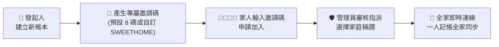
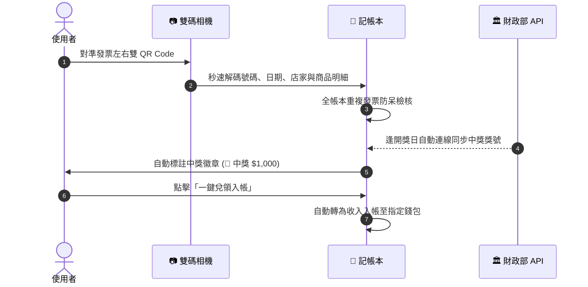
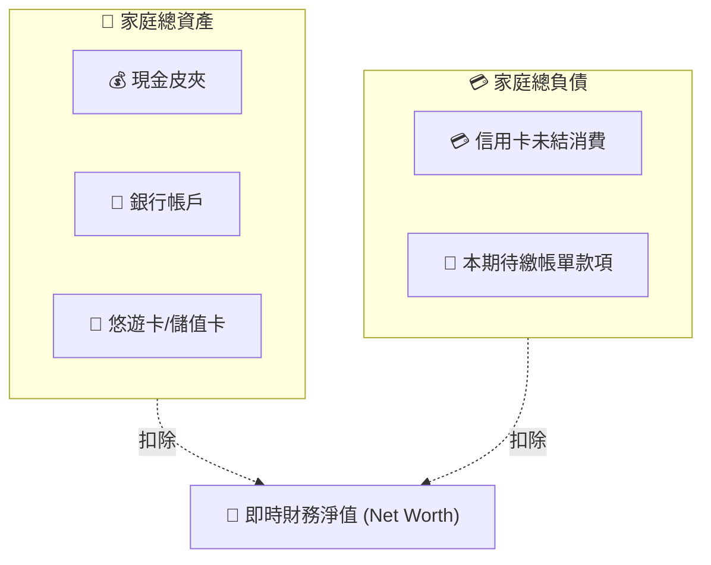
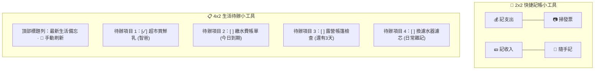

# 💖 甜心記帳本 (Sweetheart Family Ledger) 官方使用者手冊
### 打造溫暖、透明、無壓力的現代家庭共同記帳與生活手帳協同生活

---

> 📖 **「記帳不是為了斤斤計較與對帳討債，而是全家人共同守護生活的美好儀式。」**  
> 本手冊專為全體家庭成員（包括一家之主、管家伴侶、長輩與成長中的孩子）量身編撰。無論您是第一次接觸共同記帳的新手，還是希望精通進階資產對帳與桌面小工具的家庭管理員，都能在本指南中找到最清晰、最貼心的操作引導。

---

## 📑 手冊目錄快速導覽

1. [🚀 第一章：5 分鐘快速上手指南（新手開箱）](#-第一章5-分鐘快速上手指南新手開箱)
   - 1.1 [建立新的家庭帳本與專屬邀請碼](#11-建立新的家庭帳本與專屬邀請碼)
   - 1.2 [家人如何加入現有帳本](#12-家人如何加入現有帳本)
   - 1.3 [挑選家庭角色、頭貼與自訂稱謂](#13-挑選家庭角色頭貼與自訂稱謂)
   - 1.4 [身分認領與 Google 帳號綁定鎖](#14-身分認領與-google-帳號綁定鎖)
2. [💳 第二章：日常智慧記帳與多元記錄模式](#-第二章日常智慧記帳與多元記錄模式)
   - 2.1 [日常收支極速記錄（支出 / 收入 / 轉帳）](#21-日常收支極速記錄支出--收入--轉帳)
   - 2.2 [金額快捷鍵與累加計算技巧](#22-金額快捷鍵與累加計算技巧)
   - 2.3 [精準時間微調與「設為現在」快捷鍵](#23-精準時間微調與設為現在快捷鍵)
   - 2.4 [常用店家記憶與自訂分類推薦](#24-常用店家記憶與自訂分類推薦)
   - 2.5 [憑證拍照存證與長發票圖片預覽](#25-憑證拍照存證與長發票圖片預覽)
   - 2.6 [🎁 孩子零用錢雙向平衡發放](#26--孩子零用錢雙向平衡發放)
   - 2.7 [捲動進度浮動小藥丸與「剛才查看」高光錨點](#27-捲動進度浮動小藥丸與剛才查看高光錨點)
3. [🧾 第三章：電子發票掃描與全自動對獎中心](#-第三章電子發票掃描與全自動對獎中心)
   - 3.1 [雙 QR Code 相機極速掃描與明細提取](#31-雙-qr-code-相機極速掃描與明細提取)
   - 3.2 [全帳本防重複記帳防呆警告](#32-全帳本防重複記帳防呆警告)
   - 3.3 [官方開獎號碼全自動即時同步機制](#33-官方開獎號碼全自動即時同步機制)
   - 3.4 [發票對獎中心：「全部 / 我的」視角秒切與期別選擇](#34-發票對獎中心全部--我的-視角秒切與期別選擇)
   - 3.5 [中獎發票「一鍵兌領入帳」流程](#35-中獎發票一鍵兌領入帳流程)
4. [📝 第四章：生活手帳、備忘待辦與全模式連動](#-第四章生活手帳備忘待辦與全模式連動)
   - 4.1 [生活手帳手記模式（$0 記錄生活不干擾財務）](#41-生活手帳手記模式0-記錄生活不干擾財務)
   - 4.2 [生活常用範本一鍵套用（採買、露營、出國）](#42-生活常用範本一鍵套用採買露營出國)
   - 4.3 [待辦檢核清單與進度條即時核對](#43-待辦檢核清單與進度條即時核對)
   - 4.4 [國曆與農曆多重排程提醒（單次、每週、每月循環）](#44-國曆與農曆多重排程提醒單次每週每月循環)
   - 4.5 [待辦打勾辦妥確認與留言氣泡](#45-待辦打勾辦妥確認與留言氣泡)
   - 4.6 [辦妥全模式連動（支出 / 收入 / 轉帳發零用錢 / 接力待辦）](#46-辦妥全模式連動支出--收入--轉帳發零用錢--接力待辦)
5. [🗓️ 第五章：固定週期帳單與信用卡分期管理](#-第五章固定週期帳單與信用卡分期管理)
   - 5.1 [水電瓦斯、房租通訊排程建立（單月 / 雙月 / 季繳）](#51-水電瓦斯房租通訊排程建立單月--雙月--季繳)
   - 5.2 [滾動未來 7 天時間軸與到期預警](#52-滾動未來-7-天時間軸與到期預警)
   - 5.3 [收到繳費單「一鍵確認入帳」操作](#53-收到繳費單一鍵確認入帳操作)
   - 5.4 [信用卡 3~36 期分期付款追蹤與視覺進度條](#54-信用卡-336-期分期付款追蹤與視覺進度條)
6. [💎 第六章：四大資產看板、小眼睛與雙軌對帳](#-第六章四大資產看板小眼睛與雙軌對帳)
   - 6.1 [四大資產型態與即時財務淨值試算](#61-四大資產型態與即時財務淨值試算)
   - 6.2 [「個人淨值」vs「家庭淨值」視角切換](#62-個人淨值-vs-家庭淨值視角切換)
   - 6.3 [小眼睛星號遮罩與 Face ID / 指紋秒開解鎖](#63-小眼睛星號遮罩與-face-id--指紋秒開解鎖)
   - 6.4 [信用卡結帳日週期對帳與一鍵繳款](#64-信用卡結帳日週期對帳與一鍵繳款)
   - 6.5 [悠遊卡 / 一卡通專屬 ID 排他對帳與加值動態出資](#65-悠遊卡--一卡通專屬-id-排他對帳與加值動態出資)
   - 6.6 [常用支付工具管理（LINE Pay、全支付綁卡出資）](#66-常用支付工具管理line-pay全支付綁卡出資)
7. [🎯 第七章：雙視角預算控管與多維財務報表](#-第七章雙視角預算控管與多維財務報表)
   - 7.1 [家庭公帳總預算與 80% 警戒超支門檻](#71-家庭公帳總預算與-80-警戒超支門檻)
   - 7.2 [成員個人開銷額度自主配置（一人調整全家連動）](#72-成員個人開銷額度自主配置一人調整全家連動)
   - 7.3 [四大財務核心 KPI 指標解析](#73-四大財務核心-kpi-指標解析)
   - 7.4 [類別支出排行佔比與跨月收支走勢圖](#74-類別支出排行佔比與跨月收支走勢圖)
8. [📱 第八章：Android 手機桌面小工具 (Widgets) 專題](#-第八章android-手機桌面小工具-widgets-專題)
   - 8.1 [2x2 快捷記帳大圖示小工具（記支出/掃發票/記收入/記待辦）](#81-2x2-快捷記帳大圖示小工具記支出掃發票記收入記待辦)
   - 8.2 [4x2 生活手帳待辦小工具（4 則備忘、打勾直達、即時重繪）](#82-4x2-生活手帳待辦小工具4-則備忘打勾直達即時重繪)
   - 8.3 [桌面長按 Quick Actions 快捷捷徑選單](#83-桌面長按-quick-actions-快捷捷徑選單)
9. [🛡️ 第九章：帳號身分、權限防護與資料備份](#-第九章帳號身分權限防護與資料備份)
   - 9.1 [管理員生物辨識提權（10 分鐘自動降級，免記 PIN 碼）](#91-管理員生物辨識提權10-分鐘自動降級免記-pin-碼)
   - 9.2 [訪客模式與零信任安全架構](#92-訪客模式與零信任安全架構)
   - 9.3 [6 大全要素封存備份與安全合併還原](#93-6-大全要素封存備份與安全合併還原)
   - 9.4 [LINE 群組每日 Flex 圖文收支日報卡片](#94-line-群組每日-flex-圖文收支日報卡片)
10. [❓ 第十章：家庭常見問題解答 (FAQ)](#-第十章家庭常見問題解答-faq)

---

## 🚀 第一章：5 分鐘快速上手指南（新手開箱）

歡迎來到甜心記帳本！本系統支援 **Android 原生 App** 與 **電腦/手機瀏覽器網頁版**。初次使用只要完成簡單的 3 個步驟，全家人就能即時連線。

### 1.1 建立新的家庭帳本與專屬邀請碼
1. 開啟 App 或網頁版，點選首頁右上角的 **「切換帳本 ▾」** ➔ 選擇 **「＋ 建立新帳本」**。
2. 輸入溫馨的帳本名稱（例如：`幸福一家人`、`2026 日本家庭旅遊`）。
3. 系統會自動為您產生一組 **8 碼大寫英數隨機邀請碼（例如：`FAM-8823`）**；發起人亦可隨時前往「家庭設定」自由自訂為好記的 **3～15 碼專屬代碼（例如：`SWEETHOME`）**。
4. 點選「複製邀請碼」，傳送至家庭 LINE 群組即可開始邀請家人。

### 1.2 家人如何加入現有帳本
1. 家人打開手機 App 或點開網頁版連結。
2. 點選 **「加入現有帳本」**。
3. 貼上發起人分享的 8 碼邀請碼，點擊「確認加入」。
4. 系統會提示「已送出加入申請，等待管理員審核」。

> 💡 **想要免等待立即親身體驗？**  
> 歡迎在加入帳本時點擊 **「🌟 免等邀請！一鍵帶入「SWEETHOME」試玩展示帳本」**，或直接點開 [SWEETHOME 線上體驗帳本](https://mattyu99.github.io/family-ledger/?invite=SWEETHOME)，內建 28 筆家庭生活擬真消費、中獎發票與 6 大新手動手任務，開箱即玩！

### 1.3 挑選家庭角色、頭貼與自訂稱謂
1. 建立帳本時，系統已貼心預設常用家庭角色（爸爸、媽媽、大寶、二寶）。
2. 前往 **「家庭設定」➔「成員名冊」**：
   - 點擊成員卡片可更換為立體可愛的 **3D 黏土大頭貼**（共有 20+ 款風格頭像）。
   - 點擊稱謂可自由修改暱稱（例如：`智爸`、`瑩媽`、`洋洋`、`豆豆`）。

### 1.4 身分認領與 Google 帳號綁定鎖
為了保護家庭帳本資料安全，避免手機借他人使用時被誤認領身分：
- **認領身分**：家人在成員名冊中找到自己的名字，點擊「認領此身分」。
- **Google 帳號綁定鎖**：認領後強烈建議點擊 **「🔒 綁定 Google 帳號」**。
  - 綁定成功後，該成員身分即與您的 Google 信箱永久鎖定。
  - 換手機或重新安裝 App 時，只需登入同一個 Google 帳號即可瞬間自動認領歸戶，其他人無法冒用。

---

## 💳 第二章：日常智慧記帳與多元記錄模式

記帳應該像聊天打字一樣輕鬆自然。甜心記帳本提供直覺的記帳彈窗與智慧聯想功能。

### 2.1 日常收支極速記錄（支出 / 收入 / 轉帳）
點擊螢幕中央下方顯眼的 **「＋」黃色懸浮按鈕**，即刻呼叫記帳視窗：
- **💳 支出**：日常採買、餐飲、交通開銷（預設記錄於公帳）。
- **💵 收入**：薪水、獎金、投資收益、中獎發票兌領。
- **⇄ 內部轉帳**：銀行帳戶提款、悠遊卡儲值加值、家人私帳與公帳調撥（**不重複計算為家庭總支出**）。
- **📝 隨手記事**：$0 生活備忘，詳見第四章。

### 2.2 金額快捷鍵與累加計算技巧
在輸入金額時，無需切換計算機：
- 點擊鍵盤上方的快捷金額膠囊 **`+$100`**、**`+$500`**、**`+$1000`** 可進行**連續累加**！
  - *範例：點兩次 `+$500` 加上一次 `+$100`，金額自動累加至 `1100`。*
- 點擊左側的 **「清除」** 按鈕可一鍵歸零重新輸入。

### 2.3 精準時間微調與「設為現在」快捷鍵
您是否常在早上記昨晚的宵夜，導致時間軸順序顛倒？
- 在記帳彈窗中點擊時間欄位，可自由微調發生的 **時 : 分**。
- 若是剛剛當下發生的開銷，點擊 **「🕒 設為現在」** 即可自動填入當前最新時分秒。
- 儲存後系統會自動依真實時間毫秒級精準排序，時序井然有序。

### 2.4 常用店家記憶與自訂分類推薦
- 輸入店家名稱時（例如：輸入「全」），下方會自動浮現自學習的常去店家膠囊（`[全聯福利中心]`、`[全家便利商店]`）。
- 點擊店家膠囊，系統會自動連動預選對應的消費分類（例如自動選定「生鮮超市」或「餐飲伙食」），省去手動挑選分類的時間。

### 2.5 憑證拍照存證與長發票圖片預覽
- 點擊相機圖示 **「📷 拍照憑證」**，可拍攝紙本發票收據、小白單或維修保固卡存檔。
- 在明細列表中點擊「📷 憑證」徽章，即可全螢幕預覽高清憑證照片，支援長條發票手勢縮放檢視。

### 2.6 🎁 孩子零用錢雙向平衡發放
發給孩子零用錢到底該記支出還是轉帳？甜心記帳本擁有全台首創的**「雙向平衡零用錢模型」**：
1. 點擊記帳視窗頂部的 **「🎁 撥零用錢」**。
2. 選擇「出資家長」（如：智爸）與「受款孩子」（如：洋洋），輸入發放金額。
3. **儲存後系統自動完成雙向平衡**：
   - 爸媽記一筆公帳「教育育兒 / 零用錢支出」；
   - 孩子名下的零用錢錢包自動增加正向可用額度；
   - 全家公帳維持完美平衡，不生借貸壓力！

### 2.7 捲動進度浮動小藥丸與「剛才查看」高光錨點
當家庭歷史帳目累積達數百筆時：
- **浮動捲動小藥丸**：當手指上下滾動明細時，畫面底部中央會浮現半透明質感膠囊（例如：`📍 第 42 / 120 筆 · 10/15`），提示當前瀏覽進度；手指停止滾動 1.2 秒後平滑自動淡出。
- **剛才查看高光錨點**：點開任一筆明細查看或修改返回後，該卡片會維持 6 秒溫和高光藍框與 **`👁️ 剛才查看`** 徽章，讓您瞬間找回剛才閱讀的錨點！

---

## 🧾 第三章：電子發票掃描與全自動對獎中心

告別傳統逐張手動對獎與手動鍵入長串明細的痛苦，甜心記帳本提供全套電子發票自動化管線。

### 3.1 雙 QR Code 相機極速掃描與明細提取
1. 在記帳彈窗點選 **「📷 掃描發票」**（或手機桌面長按 App 圖示選擇「掃描發票」）。
2. 將鏡頭同時對準電子發票上的**左側與右側兩個 QR Code**。
3. 逼一聲秒速帶入：發票期別、發票號碼、消費金額、店家名稱，並將右側所載之**長串購買品項完整解析收納至明細備註**中！

### 3.2 全帳本防重複記帳防呆警告
- 家人之間是否常發生「老公買菜記了一次，老婆拿發票又記了一次」的重複狀況？
- 系統內建全帳本即時防重複檢測機制：只要有任何成員已記錄過相同期別與號碼之發票，輸入時畫面立即亮起紅色警示，儲存時彈出防呆提示，杜絕重複記帳。

### 3.3 官方開獎號碼全自動即時同步機制
- 每逢單月 25 日開獎日，系統在背景會 100% 全自動與財政部印刷廠連線，同步抓取最新一期中獎號碼並快取至本機。
- 只要打開 App，系統會**自動對全量歷史發票進行毫秒級對獎**，有中獎的卡片即時亮起粉紅色彩色徽章（例如：`🎉 中獎 $200 (六獎)`）。

### 3.4 發票對獎中心：「全部 / 我的」視角秒切與期別選擇
1. 點擊明細列表上方的 **「🧾 統一發票對獎中心」**。
2. **「全部 / 我的」視角切換**：
   - 切換至 **「我的」**：即時過濾僅呈現自己名下的發票張數、中獎筆數與獎金總額；
   - 切換至 **「全部」**：統整全家所有成員的共同戰果！
3. **期別軌道橫向滾動**：支援手機手勢滑動與電腦滑鼠滾輪拖曳，輕鬆回溯查閱歷史各期開獎號碼。

### 3.5 中獎發票「一鍵兌領入帳」流程
1. 在對獎中心找到中獎的發票，點擊 **「一鍵兌領入帳」**。
2. 系統會自動為您建立一筆「發票中獎收入」，並將發票狀態標記為 `✅ 已兌領`。
3. 獎金即時匯入家庭公帳或指定成員的個人錢包，帳目清晰透明！

---

## 📝 第四章：生活手帳、備忘待辦與全模式連動

家庭生活不僅是柴米油鹽的金錢收支，更是無數雜事與清單的默契分工。

### 4.1 生活手帳手記模式（$0 記錄生活不干擾財務）
- 點擊記帳彈窗頂部的 **`[ 📝 記事 ]`** 頁籤。
- 金額自動鎖定為 **$0**，可用於記錄採買備忘、居家清潔排程、孩子打疫苗日期或重要待辦。
- **嚴格排除於財務報表**：不會被誤計入月支出或總收入，家庭報表永遠純淨精準。

### 4.2 生活常用範本一鍵套用（採買、露營、出國）
在記事編輯器中點擊常用範本按鈕，一鍵帶入格式化清單：
- ✈️ **出國必備行李**：護照簽證、外幣網卡、充電轉接頭、隨身常備藥品...
- 🛒 **超市生活採買**：鮮乳豆漿、生鮮雞蛋、衛生紙、洗衣精、當季蔬菜...
- 🏕️ **親子戶外露營**：帳篷營釘、防蚊液、瓦斯爐具、睡袋睡墊、夜間照明...
- 🎒 **開學學用品準備**：文具姓名貼、便當盒水壺、室內鞋、潔牙用具...
- 🧹 **居家生活大掃除**：客廳沙發拍打除塵、抽油煙機濾網去油、衛浴水垢刷洗...

### 4.3 待辦檢核清單與進度條即時核對
- 記事內容中使用方括號 `[ ]` 或點擊「＋ 待辦方框」，即可生成互動打勾項目。
- 在總覽中直接點擊方格 `[✓]`，彩色進度條會動態計算完成度（例如：`3/5 (60%)`）。
- 當項目全數核對完成時，畫面會貼心引導：「🎉 項目已全數核對！點擊左側 ✓ 即可歸檔為已辦妥」。

### 4.4 國曆與農曆多重排程提醒（單次、每週、每月循環）
- **雙曆法支援**：支援國曆（太陽曆）與農曆（陰曆，適合初一十五拜拜、長輩農曆生日排程）。
- **靈活重複週期**：支援單次提醒、每日提醒、**每週固定日**（例如每週六清掃）、每月循環。
- 辦妥後系統會自動為您推算並接力生成下一期排程！

### 4.5 待辦打勾辦妥確認與留言氣泡
1. 當採買或差事辦妥時，點擊待辦項目左側的圓形勾勾。
2. 彈出 **「辦妥確認彈窗 (`MemoCompletionModal`)」**：
   - 選擇實際是由誰辦妥的（例如：智爸）；
   - 填寫補充說明（例如：`已在全聯買齊特價鮮乳，發票放餐桌`）；
   - 點選快捷情境標籤（`+ 已在全聯買齊`、`+ 已送達家中`、`+ 發票已留存`）。
3. 辦妥後卡片會生成優雅的**綠色留言氣泡**，家人打開 App 就能看見您的貼心交代！

### 4.6 辦妥全模式連動（支出 / 收入 / 轉帳發零用錢 / 接力待辦）
採買完要記帳，無需切換彈窗重複打字！在辦妥彈窗中點選 **「💰 連動記帳入帳」**：
- **連動支出**：自動將採買品項帶入支出記帳，金額自動計入公帳。
- **連動收入**：若是替公帳請款或代收款，可一鍵轉為收入記錄。
- **連動轉帳**：如「發放孩子成績獎學金待辦」，可直接切換連動轉帳發零用錢。
- **連動接力待辦**：如「出國準備第 1 階段辦妥」，直接接續連動至下一階段待辦清單。
- 儲存後雙向卡片彩色膠囊互通，點擊一秒跨模組跳轉查看！

---

## 🗓️ 第五章：固定週期帳單與信用卡分期管理

家庭每月固定的水電、瓦斯、電信、房租與定期訂閱，是開銷管理的大宗。

### 5.1 水電瓦斯房租電信排程建立（單月 / 雙月 / 季繳）
1. 進入底部導航 **「💳 帳單支付」** ➔ 點擊 **「⚙️ 管理規則」**。
2. 點選「＋ 新增固定帳單規則」或點選常用範本（台電電費、自來水費、天然瓦斯、手機月租）。
3. 設定週期頻率：
   - **每月固定**：房租、管理費、手機月租、寬頻網路、串流訂閱。
   - **雙月繳**：電費、水費、天然瓦斯（支援設定單月出帳或雙月出帳）。
   - **季繳 / 半年 / 年繳**：汽機車牌照燃料稅、商業保險、長照險。

### 5.2 滾動未來 7 天時間軸與到期預警
- 系統首創**「滾動未來 7 天平鋪時間軸」**（依緊急度排序：已逾期 ➔ 今日扣款 ➔ 明日預告 ➔ 未來 7 天內即將扣款）。
- 唯有在進入**扣款日前 7 天內**，底部導航「帳單支付」才會適時亮起紅色提醒點，平日絕不產生未到期的無謂虛驚紅點干擾！

### 5.3 收到繳費單「一鍵確認入帳」操作
1. 收到紙本帳單或銀行扣款簡訊時，點開「帳單支付」頂部的 **「🔔 待核對」**。
2. 點擊該筆待繳項目的 **「一鍵確認入帳」**。
3. 彈出記帳視窗確認實際出帳金額（變動金額可微調），點擊儲存。
4. 系統自動轉為公帳支出，該期帳單標記完成並自動推進至下一期！

### 5.4 信用卡 3~36 期分期付款追蹤與視覺進度條
- 當購買大型家電或手機使用分期付款時，在記帳時可選擇「分期付款」。
- 支援自訂 **3 ~ 36 期** 攤提設定。
- 系統自動產生視覺進度條（例如：`第 3/12 期 · 已繳 $15,000 / 總額 $60,000`），清楚掌握每月固定負擔何時結束。

---

## 💎 第六章：四大資產看板、小眼睛與雙軌對帳

真正清楚的家庭理財，必須隨時掌握資產與負債的即時淨值。

### 6.1 四大資產型態與即時財務淨值試算
在首頁上方設有專屬「資產看板」，全要素整合：
1. **現金**：家庭公費零用金、個人錢包現金。
2. **銀行帳戶**：常用扣款銀行活存、薪轉帳戶。
3. **儲值票證**：全家人的悠遊卡、一卡通、市民卡餘額。
4. **信用卡待繳負債**：全家所有信用卡當期已刷尚未結帳之金額。
- 系統即時動態運算：`資產總額 - 信用卡待繳 = 即時財務淨值`。

### 6.2 「個人淨值」vs「家庭淨值」視角切換
- 頂部成員篩選為特定成員（如：智爸）時：看板僅展示智爸負責的帳戶與信用卡，試算**「個人財務淨值」**。
- 頂部切換至「全部成員」時：統整全家所有人的資產帳戶，呈現全家共同的**「家庭財務淨值」**。

### 6.3 小眼睛星號遮罩與 Face ID / 指紋秒開解鎖
- **小眼睛星號遮罩**：出門在捷運或超商開 App 記帳，擔心資產金額被身後路人看見？看板金額預設啟用星號遮罩（`NT$ ••••••`）。
- **生物辨識秒解**：點擊小眼睛圖示，只需輕觸手機指紋辨識或臉部 Face ID，金額以平滑淡入動畫解鎖展示真實數字，兼顧極致安全與優雅便利！

### 6.4 信用卡結帳日週期對帳與一鍵繳款
- 傳統記帳軟體最常把月曆自然月的花費與信用卡帳單搞混。
- 在「帳單支付」點選 **「📊 對帳 ➔ 信用卡」**：
  - 系統精確依每張卡的 **「每月結帳日」** 劃分週期（例如：15 號結帳，帳期即為 9/16 ~ 10/15）。
  - 每筆消費提供核對打勾方框，收到銀行電子帳單明細時逐筆核對。
  - 繳款截止日點選 **「一鍵繳款」**，自指定銀行扣款並自動歸零該期待繳負債。

### 6.5 悠遊卡 / 一卡通專屬 ID 排他對帳與加值動態出資
- **專屬 ID 排他對帳**：各張卡片（如：`洋手環`、`豆國小卡`）獨立維護明細與即時餘額，搭車小額消費絕不交叉混淆。
- **動態加值與快捷累加鍵**：
  - 超商靠卡加值或用悠遊付 App 靠卡加值時，點選該卡片「＋ 加值」。
  - 支援 `+$100` ~ `+$1000` 累加按鈕與一鍵清除。
  - 自由選擇由誰出資（智爸現金、瑩媽信用卡、全支付等），系統自動扣抵出資管道並增加卡片餘額！

### 6.6 常用支付工具管理（LINE Pay、全支付綁卡出資）
- 前往「帳單支付」➔「管理常用付款方式」。
- 支援自訂日常使用的行動支付（如：全支付、LINE Pay、街口、悠遊付、Google Pay、台灣 Pay）。
- 行動支付可進一步綁定扣款信用卡，記帳時一鍵完成電支與信用卡雙向對帳。

---

## 🎯 第七章：雙視角預算控管與多維財務報表

管好家庭財務的關鍵，在於事前的預算規劃與事後的直觀檢討。

### 7.1 家庭公帳總預算與 80% 警戒超支門檻
- 前往「統計」或「家庭設定」➔「預算設定」。
- 管理員可設定家庭每月公帳總預算（例如：`NT$ 80,000`）。
- 首頁與統計頁面具備動態彩色進度條：
  - 綠色：安全區間（< 80%）；
  - 橙色：警戒超支提醒（80% ~ 100%）；
  - 紅色：預算超支警報（> 100%）。

### 7.2 成員個人開銷額度自主配置（一人調整全家連動）
- 除了全家公帳預算外，每位家庭成員可在自己手機上自主設定「個人開銷額度」（例如孩子月開銷額度 $3,000）。
- **WebSocket 秒級雲端同步**：成員在自己手機調整個人額度，全體家庭裝置秒級連動更新，資訊同步零時差。

### 7.3 四大財務核心 KPI 指標解析
在「統計」頁面頂部常駐四大核心財務指標：
1. **總支出**：當月全家所有生活公帳支出總和。
2. **總收入**：當月全家總收入（薪水、獎金、中獎等）。
3. **當月結餘**：總收入減去總支出後的淨儲蓄。
4. **日均消費**：當月平均每日花費，快速檢視消費節奏是否過快。

### 7.4 類別支出排行佔比與跨月收支走勢圖
- **類別佔比排行榜**：以動態長條圖由大到小排序餐飲伙食、生鮮超市、居家水電、休閒娛樂等支出佔比。
- **出資成員比例圖**：圓餅圖清晰呈現爸爸、媽媽各自為家庭公帳支出的比例。
- **跨月份快速切換**：點擊月份標籤可任意回溯查看過去歷史各月的收支趨勢對比。

---

## 📱 第八章：Android 手機桌面小工具 (Widgets) 專題

無需解鎖進入 App，手機桌面上就能隨時掌握待辦與一秒記帳！

### 8.1 2x2 快捷記帳大圖示小工具（記支出/掃發票/記收入/記待辦）
- **滿版 3D 立體黏土圖標**：精心剔除留白，圖示面積放大 2.5 倍，質感出眾。
- **4 大快捷動作**：
  - 點擊「記支出」➔ 直通支出記帳彈窗；
  - 點擊「掃發票」➔ 零等待秒開相機掃描 QR Code；
  - 點擊「記收入」➔ 直通收入記帳；
  - 點擊「記待辦」➔ 直通生活備忘手帳。

### 8.2 4x2 生活手帳待辦小工具（4 則備忘、打勾直達、即時重繪）
- **桌面展示 4 則最新待辦**：自動過濾呈現當前最緊急的今日待辦、逾期待辦與近期待辦。
- **打勾直達 App**：在桌面小工具點選任一則待辦，一鍵秒開 App 並直達該待辦的辦妥確認彈窗！
- **🔄 手動刷新鈕**：小工具右上角附帶專屬刷新按鈕，點擊立刻自雲端拉取最新資料。
- **Home 鍵廣播重繪**：每次在 App 內新增或修改待辦退出回到桌面時，系統會自動在背景發送廣播，桌面小工具秒級同步更新。

### 8.3 桌面長按 Quick Actions 快捷捷徑選單
- 長按手機桌面上的「甜心記帳本」App 圖示：
- 系統彈出系統級快捷選單：`記支出`、`記收入`、`掃描發票`、`隨手記事`。
- 支援 iOS 捷徑（Shortcuts）與 Siri 語音呼叫直通記帳。

---

## 🛡️ 第九章：帳號身分、權限防護與資料備份

家庭財務資料極其珍貴，甜心記帳本導入企業級零信任安全防禦體系。

### 9.1 管理員生物辨識提權（10 分鐘自動降級，免記 PIN 碼）
- 過去管理員修改敏感設定常需要全家背誦同一組 PIN 碼，既容易被孩子偷看又容易忘記。
- **生物辨識原生提權**：
  - 管理員點擊敏感設定時，只需通過 **Face ID / 指紋辨識** 或手機原生鎖屏碼即可秒速完成身分提權。
  - **10 分鐘無操作自動降級**：提權後 10 分鐘若無任何管理員操作，系統自動退回日常模式，杜絕他人借用手機時亂改設定。

### 9.2 訪客模式與零信任安全架構
- 任何未經主管理員審核指派的裝置或設備，僅能以「訪客模式」唯讀瀏覽公開公帳。
- 訪客**嚴格禁止修改、偽冒代記或刪除任何家庭明細**，徹底守護家庭帳本的安全邊界。

### 9.3 6 大全要素封存備份與安全合併還原
前往「家庭設定」➔「資料備份與還原」：
- **全要素 6 大領域完整封存**：包含歷史明細、成員名冊、記帳分類、支付卡片帳戶、固定週期規則與常用付款方式。
- **安全合併還原**：支援將備份檔案與現有資料進行智慧合併（自動依 ID 去重），換手機或匯入歷史資料絕不遺失任何一筆帳目。

### 9.4 LINE 群組每日 Flex 圖文收支日報卡片
- 系統支援整合 GitHub Actions 定時自動化。
- 每晚固定時間向家庭 LINE 群組推播精美設計的 Flex 圖文卡片日報：
  - 今日花費總結與出資成員清單；
  - 待辦事項提醒與即將扣款帳單預告；
  - 兼具 Supabase 雲端資料庫每日自動保活機制。

---

## ❓ 第十章：家庭常見問題解答 (FAQ)

### Ｑ1：全家一起用，手機換機後資料會不見嗎？
> **不會！** 甜心記帳本採用 Supabase 雲端即時資料庫架構。只要您的新手機輸入相同的家庭邀請碼（若有綁定 Google 帳號則直接登入 Google），所有歷史明細、分類與卡片餘額將於數秒內全量自動同步還原。

### Ｑ2：家裡長輩覺得字體太小、看不清楚怎麼辦？
> 請前往 **「家庭設定」➔「字型大小調整」**！系統提供四檔字級選擇（精簡、標準、舒適放大、特大長輩模式），並支援「跟隨手機系統字體設定」，排版具備防爆字微調，長輩使用清晰又舒適。

### Ｑ3：在地下室或賣場收訊差（無網路）時可以記帳嗎？
> **完全可以！** 系統具備完整的「離線優先 (Local-First)」架構。在無網路環境下可照常新增明細、打勾待辦；待手機重新連上網路時，系統會在背景自動補推同步至雲端，記帳永不中斷。

### Ｑ4：如果不小心誤刪了某筆重要的生活記事或收支明細，救得回來嗎？
> 建議平時養成在「家庭設定」➔「匯出備份」的良好習慣（系統具備 7/14/30 天自動提醒）。若有定期匯出 JSON 備份檔，隨時可透過「安全合併還原」一鍵復原遺失的項目。

### Ｑ5：如何避免家裡小孩亂動家庭設定或公帳總預算？
> 系統具備嚴格的權限分級制：只有「主管理員」與「被授權的管理員」能調整公帳總預算與家庭帳本設定；一般成員僅具備記錄個人收支與檢視權限，且管理員操作需要通過生物辨識提權保護。

---

> 💖 **甜心記帳本 —— 讓每一筆柴米油鹽的日常，都化作守護家庭溫暖的足跡。**

